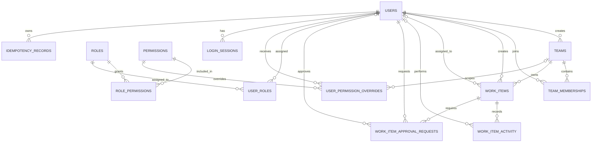

# OpsPilot — Database Details

## 1. Overview

OpsPilot uses PostgreSQL as its primary database. It stores user accounts, teams, work items, approvals, activity history, authorization rules, login sessions, and idempotency records.

The database is designed to keep operational data consistent while supporting multiple users working on the same application.

The schema is organized around five main responsibilities:

- **Identity:** Users and login sessions.
- **Team management:** Teams and their memberships.
- **Authorization:** Roles, permissions, and individual permission overrides.
- **Work management:** Work items, approval requests, and activity history.
- **Request reliability:** Idempotency records for handling repeated requests safely.

The database uses UUIDs as primary identifiers, foreign keys to connect related records, constraints to prevent invalid data, and indexes to support frequently used queries.

## 2. Database Schema

The following diagram shows the main tables and their relationships.

The diagram represents the logical relationships between tables. Some relationships are optional, such as a work item's assignee or an activity record's actor.

## 3. Table Details

### 3.1 Users

**Table:** `users`

Stores the accounts of people using OpsPilot.

Important columns:

| Column | Purpose |
|---|---|
| `id` | Unique identifier for the user. |
| `full_name` | User's display name. |
| `email` | User's email address. |
| `password_hash` | Stored password hash, not the original password. |
| `account_status` | Indicates whether the account is active, suspended, or deactivated. |
| `created_at` | Account creation time. |
| `updated_at` | Last recorded update time. |

The email address is protected by a case-insensitive unique index, so the same email cannot be registered with different letter casing.

The database also prevents empty or whitespace-only names.

### 3.2 Teams and Team Memberships

**Tables:** `teams`, `team_memberships`

The `teams` table stores team information, including its name, description, creator, and timestamps.

The `team_memberships` table connects users to teams.

Important membership fields include:

- `team_id`: The team the user belongs to.
- `user_id`: The associated user.
- `role`: The user's role within that team.
- `joined_at`: When the membership was created.

Team membership roles are:

- `lead`
- `member`
- `approver`

A unique constraint on `(team_id, user_id)` prevents the same user from being added to the same team more than once.

Team membership roles describe responsibilities within a particular team. They are separate from the system-wide roles used for authorization.

### 3.3 Roles and Permissions

**Tables:** `roles`, `permissions`, `role_permissions`, `user_roles`, `user_permission_overrides`

These tables provide the database structure for OpsPilot's authorization system.

| Table | Purpose |
|---|---|
| `roles` | Defines named roles and whether they have system or team scope. |
| `permissions` | Stores individual permission definitions. |
| `role_permissions` | Connects roles to the permissions they grant. |
| `user_roles` | Assigns system-level roles to users. |
| `user_permission_overrides` | Stores user-specific allow or deny overrides, optionally scoped to a team. |

The `role_permissions` table uses a composite primary key to prevent duplicate role-permission assignments.

Permission overrides support both global and team-specific rules. Their unique constraint prevents duplicate overrides for the same user, permission, and scope.

The database stores these authorization relationships; the backend is responsible for evaluating them when a request is made.

### 3.4 Work Items

**Table:** `work_items`

This is the central table of OpsPilot. It stores the operational tasks or issues that teams need to manage.

Important columns:

| Column | Purpose |
|---|---|
| `id` | Unique work-item identifier. |
| `title` | Short description of the work. |
| `description` | Details about the task or issue. |
| `type` | Category of work. |
| `status` | Current lifecycle state. |
| `priority` | Importance of the work item. |
| `team_id` | Team responsible for the work. |
| `created_by` | User who created it. |
| `assignee_id` | User assigned to handle it; can be empty. |
| `created_at` | Creation time. |
| `updated_at` | Last recorded update time. |
| `completed_at` | Completion time for resolved items. |

Supported work-item types are:

- `investigation`
- `action`
- `incident`
- `approval`

Supported statuses are:

- `open`
- `in_progress`
- `pending_approval`
- `resolved`
- `cancelled`

Supported priorities are `low`, `medium`, `high`, and `critical`.

Database constraints prevent invalid type, status, and priority values. They also ensure that a resolved item has a completion timestamp and a non-resolved item does not.

Work items are cancelled by changing their status to `cancelled`, rather than deleting the record. This preserves the work item's history.

### 3.5 Work Item Activity

**Table:** `work_item_activity`

Stores the history of actions performed on work items.

Important columns:

- `work_item_id`: The work item associated with the activity.
- `actor_id`: The user who performed the action, when available.
- `action`: The type of action recorded.
- `details`: Additional information stored as JSONB.
- `created_at`: When the action was recorded.

Examples of actions include work-item creation, assignment changes, status changes, and approval decisions.

The activity table provides a historical record of operational changes. Its `details` column allows additional information to be stored without requiring a separate database column for every action type.

Activity records reference their work items, and the schema prevents deleting a work item while its activity records still reference it.

### 3.6 Work Item Approval Requests

**Table:** `work_item_approval_requests`

Stores approval requests associated with work items.

Important columns:

| Column | Purpose |
|---|---|
| `work_item_id` | Work item requiring approval. |
| `requested_by` | User who requested approval. |
| `approver_id` | Assigned approver, if one has been assigned. |
| `status` | Current approval decision state. |
| `decision_reason` | Optional explanation for the decision. |
| `requested_at` | Time the request was created. |
| `decided_at` | Time the request was decided. |

Supported approval statuses are:

- `pending`
- `approved`
- `rejected`

A database constraint ensures that pending requests have no decision timestamp, while approved and rejected requests must have one.

Approval requests are stored separately from work items because a work item and its approval history represent different things: the operational work itself and the decisions made about it.

### 3.7 Login Sessions

**Table:** `login_sessions`

Stores login-session information associated with users.

Important columns include:

- `user_id`: The owner of the session.
- `refresh_token_hash`: The stored hash associated with the refresh token.
- `expires_at`: When the session expires.
- `revoked_at`: When the session was revoked, if applicable.
- `created_at`: When the session was created.

Refresh tokens are represented by their hashes rather than storing the original token in this table.

The schema checks that session expiry occurs after creation and that any revocation timestamp is not earlier than the creation timestamp.

### 3.8 Idempotency Records

**Table:** `idempotency_records`

Stores information used to safely handle repeated requests.

Important columns:

- `user_id`: User associated with the request.
- `idempotency_key`: Identifier used to recognize a repeated request.
- `request_hash`: Hash representing the request payload.
- `response_status`: Stored response status.
- `response_body`: Stored response body in JSONB format.
- `created_at`: Record creation time.
- `expires_at`: When the record expires.

A unique constraint on `(user_id, idempotency_key)` prevents duplicate idempotency records for the same user and key.

The response status and response body must either both be present or both be absent. An expiry constraint ensures the expiration time is later than the creation time.

These records support safe retries of operations that should not produce duplicate effects. The backend implements the actual idempotency behaviour.

## 4. Relationships Between the Main Tables

The main relationships can be summarized as follows:

1. A user can belong to multiple teams through `team_memberships`.
2. A team can contain multiple members and own multiple work items.
3. A work item belongs to one team and records its creator and optional assignee.
4. A work item can have multiple activity records.
5. A work item can have multiple approval requests over its lifecycle.
6. Roles connect to permissions through `role_permissions`.
7. Users receive system roles through `user_roles`.
8. User permission overrides can apply globally or to a specific team.
9. Users can have multiple login sessions and idempotency records.

Foreign keys maintain these relationships and help prevent orphaned records.

## 5. Constraints and Data Integrity

The schema uses database-level rules to protect important data.

### Primary keys

Every main entity has a UUID primary key. The role-permission and user-role relationship tables use composite primary keys.

### Foreign keys

Foreign keys connect related records and define what happens when a referenced record is deleted.

For example, deleting a team cascades to its memberships, while work items restrict deletion of their owning team.

### Unique constraints

Unique constraints prevent duplicate team names, memberships, role-permission assignments, and idempotency keys within their specified scopes.

User emails are made unique case-insensitively.

### Check constraints

Check constraints enforce allowed account statuses, team roles, work-item types, statuses, priorities, approval statuses, and valid timestamp combinations.

### Historical preservation

Work items cannot be deleted while activity or approval records reference them. This supports the application's requirement to retain operational history.

## 6. Indexing and Query Performance

Indexes are created around common lookup and filtering patterns.

| Table | Indexing purpose |
|---|---|
| `users` | Case-insensitive email lookup. |
| `team_memberships` | Find memberships belonging to a user. |
| `user_roles` | Find users assigned to a role. |
| `role_permissions` | Find roles containing a permission. |
| `user_permission_overrides` | Look up overrides by user, team, and permission. |
| `work_items` | Filter by team, status, priority, assignee, and creator; order team work by update time. |
| `work_item_activity` | Retrieve a work item's latest activity and activity by actor. |
| `work_item_approval_requests` | Find pending approvals for an approver and retrieve approvals for a work item. |
| `login_sessions` | Find sessions by user and expiry time. |
| `idempotency_records` | Find records approaching or past their expiry time. |

Some indexes are partial indexes. For example, the assignee/status index only includes work items that have an assignee, and the pending-approval index only includes requests whose status is `pending`.

These indexes support common application queries without requiring every query to scan an entire table. Actual performance still depends on query design, data volume, and database configuration.

## 7. Design Summary

OpsPilot's database is organized around a clear separation of responsibilities:

- User and team tables represent people and organizational structure.
- Authorization tables represent roles and permissions.
- Work-item tables represent operational tasks.
- Approval and activity tables represent decisions and historical changes.
- Session and idempotency tables support authentication and reliable request processing.

PostgreSQL constraints enforce basic data integrity, foreign keys maintain relationships, and indexes support frequently used access patterns.

The schema provides the foundation for a consistent multi-user operations platform. Business rules, authorization decisions, and request-processing behaviour are enforced by the backend Services and Operations layers working with the database.
